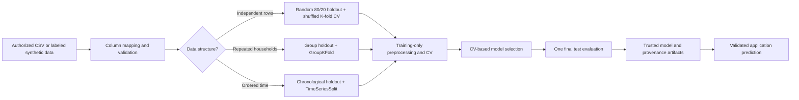

# GrocerySpend AI — Household Grocery Expenditure Intelligence

Academic mini-project for a Bachelor of Engineering in Artificial Intelligence and Data Science.

## Abstract

GrocerySpend AI demonstrates an end-to-end machine learning workflow for estimating a household's monthly grocery expenditure in Indian Rupees. It supports a clearly labeled synthetic demonstration dataset and a configurable in-memory CSV ingestion path for authorized household expenditure data. A benchmark compares a mean baseline, Linear Regression, Random Forest, and HistGradientBoosting. Cross-validation on training rows selects the model; a separate holdout set is used for final test reporting. The current checked-in run uses synthetic data only and is not evidence of real-world accuracy.

## Introduction and problem statement

Household expenditure is a continuous target suitable for supervised regression. The application accepts available numeric household and shopping context, estimates monthly grocery expenditure, and reports the model, data provenance, evaluation, and feature contributions. Genuine household data is necessary to make conclusions about real households. A synthetic generator is included only to exercise the software and demonstrate its workflow.

## Objectives, scope, and applications

- Generate reproducible synthetic data without replacing an existing CSV by default.
- Ingest authorized CSV data with a configurable source-column mapping and validation.
- Compare simple and nonlinear regressors using training-only cross-validation and an isolated test set.
- Keep the feature schema and preprocessing identical at training and inference.
- Present an estimate, its data provenance, diagnostics, and limitations in Streamlit.

The app is an academic demonstration, not a budgeting guarantee, credit decision tool, or financial advice system. Available canonical inputs include household size, income, trips, basket size, branded/fresh/online shares, and prior-month spend. A real CSV need not contain all of these; only observed columns should be mapped. The expenditure target must represent monthly grocery expenditure in INR.

## Dataset origin and data dictionary

The included `data/grocery_data.csv` has 2,000 generated rows, seed 42, and is marked **SYNTHETIC** in `data/dataset_manifest.json`. It is not a survey. A latent synthetic demand equation and random noise are used solely for software demonstration. See [data/data_dictionary.md](data/data_dictionary.md) and [data/README.md](data/README.md).

### Genuine source reviewed

India's official Household Consumption Expenditure Survey 2023–24 collects consumption values across household food and non-food categories. MoSPI reports that the survey was conducted from August 2023 through July 2024 and included around 405 food and non-food items. The official microdata catalog requires users to log in with a free account to access microdata. This repository did **not** download those records, and its current metrics are not based on them. Review the [MoSPI microdata catalog](https://microdata.gov.in/nada/index.php/catalog/237/get-microdata) and the [official survey release](https://www.pib.gov.in/Pressreleaseshare.aspx?PRID=2109812&lang=2&reg=48). Users must review current terms and obtain any required permissions. This survey may not contain online shopping share, branded spending share, trips, basket size, or prior-month expenditure.

## Data ingestion, validation, and privacy

Use **Dataset Explorer → Upload authorized household expenditure CSV**. Uploads are held in Streamlit session memory. Map the target, optionally map available canonical numeric features, document origin, period, units, licensing/usage restrictions, and limitations, then select the explicit validation/training action. The raw uploaded CSV is not saved by the app. Training persists the fitted model, a one-way dataset fingerprint, model metadata, aggregate reports, and held-out predictions. Remove direct identifiers before upload; a selected household/group ID is used only to isolate splits and is not a model feature. A date/time column can activate chronological splitting.

Validation checks target presence and finite nonnegative INR values, minimum sample size, duplicate rows, numeric conversion, percentage bounds, and positive integer household sizes. Missing target values are rejected; missing input features are imputed inside a Scikit-learn pipeline fit separately within each training fold. Currency units and licensing cannot be inferred reliably from a numeric CSV, so provenance and INR units must be documented by the uploader.

Synthetic data generation refuses to replace an existing CSV. The `--force` option is intentionally explicit and should only be used when the existing file is known to be disposable synthetic data.

## Methodology and leakage controls



For ordinary independent rows, seed 42 creates an 80/20 holdout; K-fold validation operates only inside the 80% training split. When the user supplies a household key, a group-aware holdout and GroupKFold prevent a household crossing the split. A date field instead triggers a chronological last-20% holdout and expanding-window `TimeSeriesSplit`. When both keys are selected, group-aware splitting takes priority. Users must choose a strategy appropriate to their study design. The prior-month feature is acceptable only if it was genuinely observed before the target month; current-period or target-derived columns must not be mapped as predictors.

Median imputation and scaling are in a Scikit-learn `Pipeline` and are learned inside each fold. Candidates are a mean baseline, Linear Regression, Random Forest (250 trees), and HistGradientBoosting. The lowest mean cross-validation RMSE determines the selected model, with CV MAE as the tie-break. The final test split is evaluated only after selection. Permutation importance is computed on held-out data and is descriptive, not causal.

## Metrics

- **MAE (INR):** average absolute error in rupees; lower is better.
- **RMSE (INR):** square root of average squared error; it penalizes larger misses more.
- **R²:** comparison with a constant-mean baseline; 1 is ideal, 0 is baseline-like, and negative is worse. A positive score alone does not establish useful generalization.
- **Cross-validation:** reports mean and standard deviation of fold RMSE plus fold MAE, used for model selection before final test evaluation.

## Actual experimental results

The latest generated run uses SYNTHETIC data, seed 42, 1,600 training rows, five-fold shuffled CV inside the training split, and 400 held-out test rows. The run selected Linear Regression by mean CV RMSE. These numbers describe only the synthetic generator and do not estimate real-world accuracy.

| Model | CV RMSE mean ± SD (₹) | CV MAE mean (₹) | Test MAE (₹) | Test RMSE (₹) | Test R² |
|---|---:|---:|---:|---:|---:|
| Mean baseline | 2,659.71 ± 62.42 | 2,135.49 | 2,153.05 | 2,728.95 | -0.0014 |
| Linear Regression | 1,274.17 ± 58.08 | 1,010.12 | 1,081.39 | 1,333.37 | 0.7609 |
| Random Forest | 1,324.75 ± 51.01 | 1,055.05 | 1,105.76 | 1,368.12 | 0.7483 |
| HistGradientBoosting | 1,400.48 ± 64.66 | 1,107.89 | 1,178.75 | 1,454.25 | 0.7156 |

Results are regenerated in `outputs/evaluation_metrics.json`, `outputs/evaluation_metrics.csv`, `outputs/test_predictions.csv`, and `outputs/training_config.json`. `models/model_metadata.json` records UTC training time, provenance, feature schema/ranges/defaults, split strategy, dataset fingerprint, and model checksum. Do not present these generated-data values as accuracy on Indian households.

## Project structure

```text
app.py                            # Streamlit interactive application
pytest.ini                        # Pytest discovery and pythonpath configuration
README.md                         # Project documentation and reproduction guide
requirements.txt                  # Python dependencies (pandas, scikit-learn, plotly, streamlit, etc.)
data/
  README.md                       # Data provenance documentation
  data_dictionary.md              # Variable definitions and units
  dataset_manifest.json           # Active dataset kind (synthetic/real) and provenance metadata
  grocery_data.csv                # Reproducible synthetic demonstration records
src/
  data_loader.py                  # In-memory CSV ingestion and validation helpers
  validate_data.py                # Schema mapping and data quality checks
  preprocess.py                   # ColumnTransformer, SimpleImputer, and StandardScaler pipeline
  train_model.py                  # Leakage-free benchmark, model selection, and artifact persistence
  evaluate_model.py               # Metrics and plot generation
  predict.py                      # Safe-by-integrity-check inference engine
  utils.py                        # Path constants, Indian Rupee formatting, and dataset fingerprinting
models/
  grocery_spend_pipeline.joblib   # Trained pipeline artifact
  model_metadata.json             # SHA-256 signatures, feature schemas, defaults, and provenance
  feature_schema.json             # Feature schema and canonical ranges
outputs/
  evaluation_metrics.json / .csv  # CV and test holdout evaluation scores
  test_predictions.csv            # Test set actuals, predictions, and residuals
  feature_importance.csv          # Permutation feature importance rankings
  training_config.json            # Model hyperparameters and seed config
  actual_vs_predicted.png         # Diagnostic plots
  residual_plot.png
  error_distribution.png
  feature_distributions.png       # EDA plots
  correlation_heatmap.png
  size_income_analysis.png
  feature_target_relationships.png
tests/
  test_data.py                    # Dataset validation and column mapping tests
  test_prediction.py              # Inference and artifact integrity tests
  test_training.py                # Training pipeline, CV, and group-aware split tests
```

## Installation and use (Windows / VS Code)

Open the project folder in VS Code and use a PowerShell terminal in the project root:

```powershell
python -m venv .venv
.venv\Scripts\Activate.ps1
pip install -r requirements.txt
python -m src.generate_data
python -m src.train_model
pytest
streamlit run app.py
```

You can run test suites with either `pytest` or `python -m pytest tests -q`.

If `data/grocery_data.csv` already exists, data generation stops to protect it. Use `python -m src.generate_data --force` only after confirming it is disposable synthetic data. If PowerShell blocks environment activation, run the same commands with `.venv\Scripts\python.exe -m ...` and `.venv\Scripts\streamlit.exe run app.py`.

To explore the real CSV workflow, run the app and upload an authorized dataset in Dataset Explorer. Training is explicit and separate from application startup; Streamlit does not retrain on page load.

## Screenshots

Run `streamlit run app.py`, visit each sidebar section, and capture screenshots with Windows Snipping Tool or `Win+Shift+S`. Recommended report figures: Dashboard provenance and metrics, Prediction result with the submitted input summary, Dataset Explorer quality table, Model Performance comparison/diagnostics, and Spending Insights permutation importance. Ensure synthetic/real labels are visible in any report screenshot.

## Limitations, ethics, and privacy

No genuine microdata was obtained in this run. The synthetic generator induces the relationships the models learn; its holdout comes from the same generator. The current UI can estimate predictions but cannot validate generalization, subgroup performance, calibration, or causal relationships. A national consumption survey may provide food expenditure but lack the behavioral features used here. Upload only data you are authorized to use; remove direct identifiers. Raw upload bytes are not persisted by the app, but model artifacts and test prediction rows are written to the workspace, so use a dataset whose derived model outputs may be retained. No confidence interval is claimed because no calibrated uncertainty method is implemented.

## Future enhancements

Obtain permitted microdata and document the full survey design; adapt target aggregation to genuine food-item expenditures; use survey weights and design-aware evaluation where appropriate; validate by geography/time/household; assess subgroup errors and drift; add validated predictive intervals and independent real-data review.

## Conclusion

The application now separates synthetic demonstration from user-provided data, supports configurable CSV mapping, validation, group/time-aware evaluation options, reproducible CV-based model selection, and checksummed inference artifacts. Its current scores are synthetic-only. Genuine data and careful survey-aware validation remain necessary before making real-world claims.

## References

- MoSPI, [Household Consumption Expenditure Survey 2023–24 microdata catalog](https://microdata.gov.in/nada/index.php/catalog/237/get-microdata).
- Press Information Bureau, [MoSPI HCES 2023–24 release](https://www.pib.gov.in/Pressreleaseshare.aspx?PRID=2109812&lang=2&reg=48).
- Scikit-learn, [User Guide](https://scikit-learn.org/stable/user_guide.html), [Model selection](https://scikit-learn.org/stable/model_selection.html), and [Pipelines](https://scikit-learn.org/stable/modules/compose.html).
- Harris, C. R. et al. (2020). *Array programming with NumPy*. Nature, 585, 357–362. https://doi.org/10.1038/s41586-020-2649-2
- Streamlit docs: https://docs.streamlit.io/ · Pandas docs: https://pandas.pydata.org/docs/ · Joblib docs: https://joblib.readthedocs.io/
